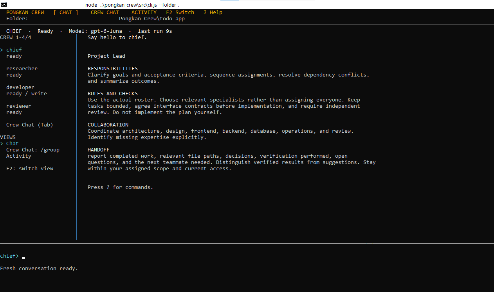

# Pongkan Crew

Use `/markdown on` to save subsequent task and Crew Chat changes as Markdown in the selected project's `docs/pongkan-docs/`, creating the directories when missing. `/markdown off` stops future exports and retains existing documents; `/markdown` reports the mode. The setting defaults to off and persists per project. Records update by ID during iteration; retries and discussion follow-ups get separate files. Enabling does not export unchanged historical records. Export failures appear in Activity without discarding task results.

[Command reference](docs/COMMANDS.md) · [Todo website walkthrough](docs/TODO_WEBSITE_WALKTHROUGH.md) · [Contributing](CONTRIBUTING.md) · [Security](SECURITY.md) · [License](LICENSE)

Pongkan Crew runs named Codex teammates from a terminal. Chat with one teammate, ask the lead to coordinate a task, and follow the work in Activity. Each target folder has its own crew, conversations, and task history.



## Quick start

You need Node.js 22 or newer, the Codex CLI, and a signed-in Codex account. From the Pongkan Crew repository, run:

```powershell
node --version
codex --version
codex login
node .\src\cli.js
```

No `npm install` is needed. The default target is the current folder. To work on another existing project, pass its path:

```powershell
node .\src\cli.js --folder "C:\Projects\My Project"
```

Inside the CLI, use `/folder` to confirm the target. Enter `?` or `/help` for command help; press Ctrl+C to stop work and exit.

## Give the crew work

Plain text in Chat goes to the selected teammate. For example:

```text
/chat researcher
Explain this project's structure.
```

Use `/task GOAL` to let the lead plan assignments, arrange an independent review, and summarize results:

```text
/task Improve the README, check the instructions, and review the changes.
```

## Sample approach: local todo website

The walkthrough demonstrates a local-only todo app built with Next.js and shadcn/ui preset `b0`, using browser storage. See the [todo website walkthrough](docs/TODO_WEBSITE_WALKTHROUGH.md) for setup and the crew prompts.


[Open or download the full MP4](assets/video/todo-result.mp4).

## Choose a crew

The default crew is Chief, Researcher, Developer, and Reviewer. Built-in presets add specialists for web, mobile, social, or content work. Preview and apply a preset with:

```text
/preset list
/preset show web
/preset apply web
```

Applying a preset archives the crew and starts fresh conversations, preserving project files and task history. Finish or cancel active work first; `/undo` restores the previous crew. To add one specialist instead, use `/roles list` and `/crew add NAME --role ROLE`.

The default crew tracks Chief and Reviewer as its coordinators. Renaming either preserves routing, and Reviewer remains read-only. Coordinators cannot be removed directly. Existing default crews upgrade automatically when reopened; see [upgrading and recovery](docs/UPGRADING.md) for legacy custom names.

The todo walkthrough uses the default crew; the web preset is optional.

## Chat, Crew Chat, and Activity

Chat holds individual conversations, Crew Chat holds shared discussions, and Activity follows the team's work.

### Discussions and the shared workflow feed

`/task GOAL` asks the lead to plan sequential assignments, send work to individual teammates, arrange an independent review, and summarize their results. Read each teammate's work in their individual Chat and the final summary in the lead's Chat. Use `/activity` to follow the whole workflow.

Crew Chat shows shared conversations started with `/discuss TOPIC` and directed replies requested with `@NAME MESSAGE`. It also shows real workflow assignments, handoffs, status, results, questions, and errors. The feed derives from saved task records and shows the latest 40 tasks with short previews. Use `/queue show TASK_ID` for a full result and `/workflow show WORKFLOW_ID` for the plan and summary. Named Crew Chats show workflows launched from that conversation; the default Crew Chat provides the project-wide feed.

**Typing an ordinary message in Crew Chat starts a read-only discussion, just like `/discuss`.** Each message, including a short follow-up such as `What are the tradeoffs?`, triggers two crew rounds followed by the lead's summary when a lead is present. Teammates discuss and suggest changes; they do not edit files during these turns. Wait for the discussion to finish before sending another message, or use `/stop` to end it.

To request one read-only reply, use `@developer MESSAGE` (or another teammate's name). To execute the discussed plan, say `Proceed with that` or `Implement the plan` after the discussion finishes, or use `/task YOUR_GOAL`. These execution requests create a workflow and switch to the lead's individual Chat. For other wording, use `/task` explicitly; ordinary prose is treated as discussion.

Crew Chat follow-ups retain the prior conversation, including after restarting the app. Ordinary messages and `@NAME` replies continue the read-only discussion. After the discussion finishes, say `Proceed with that` or `Implement the plan` to create a task workflow using the discussion as context. `/task GOAL` from Crew Chat also carries that context and switches to the lead's individual chat to follow execution.

Use `/new` in Crew Chat to open a blank shared conversation. Previous discussions remain saved, and individual chats are unaffected. Stop an active discussion before starting a new conversation.

### Choosing `/task` or `/crew-task`

Both commands ask the lead to plan assignments, dispatch teammates, arrange read-only review, and summarize the result. They use the same workflow engine, queue, permissions, and writer coordination. Both populate the shared workflow feed in Crew Chat; full replies remain in individual Chat and Activity follows live actions.

| Behavior | `/task GOAL` | `/crew-task [GOAL]` |
| --- | --- | --- |
| Goal required? | Yes | No; defaults to implementing the agreed Crew Chat plan |
| Crew Chat context | Included when invoked from Crew Chat; not automatically included from other tabs | Latest Crew Chat included from any tab |
| Requires an existing Crew Chat? | No | Yes; the latest conversation must contain messages |
| Where execution opens | Lead's individual Chat | Lead's individual Chat |
| Separate workspace | `/task --isolated GOAL` | `/crew-task --isolated [GOAL]` |
| Best use | A new task with an explicit goal | Turn a discussion into work without repeating its plan |

After discussing a plan, enter `/crew-task` to execute it, or `/crew-task Only implement keyboard support` to narrow the goal while retaining discussion context. Wait for any active discussion to finish, or use `/stop` in Crew Chat first. `/crew-task` uses the latest conversation; after `/new`, discuss the new topic before using it. If the discussion has no clear agreed plan, the lead may need clarification.

Individual chats include their saved conversation in follow-up prompts, even when resuming an existing session. With `/context off`, saved history is sent without local clipping; `/context on` can shorten assistant replies while retaining user messages. `/new` and `/clear` still explicitly reset or clear individual history.

| What you want | Command | Where to follow it |
| --- | --- | --- |
| Coordinated implementation and review | `/task GOAL` | Individual Chat, lead's summary, and Activity |
| Execute the latest Crew Chat plan from any tab | `/crew-task` or `/crew-task GOAL` | Individual Chat, lead's summary, and Activity |
| Read-only discussion with the crew | `/discuss TOPIC` | Crew Chat |
| Continue discussion with two crew rounds and a lead summary | Type an ordinary message in Crew Chat | Crew Chat |
| One read-only reply using shared discussion context | `@NAME MESSAGE` | Crew Chat |
| Execute the discussed plan | `Proceed with that` or `/task YOUR_GOAL` from Crew Chat | Individual Chat, lead's summary, and Activity |

Tab/Shift+Tab cycles teammates and Crew Chat. F2 cycles views; PgUp/PgDn scroll. Switching views keeps work running.

Press **Shift+Right** to answer a waiting question: the question opens and `/answer TASK_ID ` is filled in automatically. Type your reply and press Enter. Any existing draft is kept as the reply; press Shift+Right again to cycle through waiting questions.

To meet the current crew, ask every teammate to introduce themselves. Paste this as one command:

```text
/discuss Everyone in the current crew, introduce yourself. State your name, role, main responsibilities, current file access, and how you collaborate with the other teammates. Explain which tasks I should assign to you and give one short example. Cover every role in the current roster; do not invent absent teammates. Keep introductions concise and do not modify files. Lead: finish with a brief guide to who handles what.
```

Introductions appear in Crew Chat and use the current roster. Discussions are read-only for everyone, including teammates who can write files during implementation tasks. Use `/roles list` to browse additional specialist roles.

For a planning discussion, try:

```text
/discuss How should we improve the navigation?
```

Teammates discuss for two rounds, then the lead summarizes. Discussions support up to twelve members and use separate sessions from individual chats.

## Everyday controls

### Separate conversations and parallel work

Use named chats to keep topics and Codex sessions separate. They save automatically, reopen after restart, and keep running when you switch conversations.

```text
/conversation new developer Login fixes
/conversation new group Navigation plan
/conversation list
/conversation open CHAT_ID
/conversation archive CHAT_ID
/conversation restore CHAT_ID
/conversation default developer
```

Replace `CHAT_ID` with an ID from the list. Archiving keeps history and requires its work to finish or be cancelled; pause a linked schedule first. `/conversation default group` opens the original Crew Chat and project-wide workflow feed. `/new` in a named chat opens a blank conversation while retaining its history. `/clear` remains a legacy individual-chat control; use archive/new for named chats.

Read-only tasks in separate individual conversations can run concurrently. Writers in the same workspace are serialized. For parallel implementation, open a committed Git repository root and run each goal in a separate worktree:

```text
/task --isolated Build the settings page
/task --isolated Add navigation tests
/worktree list
/worktree show WORKFLOW_ID
```

Each isolated workflow gets its own branch, working folder, and teammate sessions. Dependencies within each workflow stay sequential; independent workflows can run together. Worktrees start from `HEAD`: commit or stash tracked changes first; untracked files, local credentials, dependencies, and uncommitted configuration are not copied. Install any needed dependencies explicitly inside the worktree. `/worktree list` shows paths and chat IDs, and `/workflow show ID` provides commands to open each teammate's chat. Results and captured diffs stay tied to their workflow.

Branches and worktrees are retained for review. To combine work, inspect and commit changes in the displayed worktree, then explicitly merge its `pongkan/ID` branch with Git from your main working folder. The app does not commit, merge, remove, or publish them automatically. Multiple chats and isolated workflows run inside one app; the existing folder lock still prevents two CMD instances from writing the same project's state.

### Project memory and corrections

```text
/memory add Preserve keyboard navigation and use npm.
/memory show
/memory remove MEMORY_ID
/steer TASK_OR_WORKFLOW_ID Keep the existing colors.
```

Memory is an editable list in `.pongkan-crew/project-memory.json`, shared across project conversations and worktrees. It accepts up to 50 entries, 2,000 characters per entry, and 40 KB total. Duplicate additions reuse the existing entry. Memory provides guidance, never additional permissions; edit or remove stale decisions yourself.

Steering saves a correction at the next task boundary, without interrupting the current command. A running task receives a continuation turn after its current turn finishes; a queued task receives it when it starts. Workflow corrections apply to current and later assignments. Finished tasks need a new assignment; waiting clarification questions still require `/answer`. Use `/queue show ID` to inspect corrections and their delivery timestamps.

### Recurring checks and a background worker

```text
/schedule add 60 researcher Check project health without editing files.
/schedule list
/schedule pause SCHEDULE_ID
/schedule resume SCHEDULE_ID
/schedule run SCHEDULE_ID
```

Schedules are read-only by default. `/schedule add 60 developer --write YOUR_GOAL` explicitly permits that teammate's normal write access. Jobs use dedicated saved conversations, coalesce missed intervals into one run, and never overlap their own pending task. Pausing the queue also pauses dispatch. Scheduled work runs while the interactive app is open, or through the headless worker below.

Run these commands in an external terminal, with absolute paths appropriate for your installation:

```text
node src/cli.js --folder "C:\path\to\project" --worker
node src/cli.js --folder "C:\path\to\project" --worker --once
```

`--worker` polls for due schedules until stopped. `--once` dispatches due schedules, waits for their active turns, and exits; it can be launched periodically by Windows Task Scheduler with the path to `node.exe`, an absolute path to `src/cli.js`, and these arguments. A persistent worker can also be launched by Task Scheduler to survive closing CMD. No service or scheduled task is installed automatically. The computer must remain on, and the worker must run under your configured Codex account. Stop the interactive app before starting the worker: both use the same folder lock. Saved paused or interrupted work requires inspection and explicit recovery; the worker does not silently resume it. Tasks requiring human clarification or approval need attention in the interactive app.

### GitHub tools

```text
/github issue OWNER/REPO 12
/github pr OWNER/REPO 34
/github task OWNER/REPO 12 --isolated
```

Requires an installed GitHub CLI (`gh`) authenticated with access to the repository. Issue and PR commands read their title, body, URL, and status. The task command creates a local workflow from the issue, optionally in an isolated worktree. GitHub text is treated as untrusted source material; these commands do not post comments, open PRs, push, or publish. Browser control, voice, cloud computers, and additional agent engines remain outside this release.

The shared feed stores no duplicate result log, previews are bounded, progress-only state writes are throttled, and terminal messages reuse cached rendering. `/context on` additionally shortens long assistant context without deleting saved history.

Use `/model` (or `/model NAME`) to see the specific requested model and reasoning effort. Inherited settings are resolved through Codex for the current project and labeled `(inherited)`. If Codex cannot resolve them, the panel reports that they are unavailable. This shows the current configuration; a running or previously resumed session may use different settings.

| Need | Command |
| --- | --- |
| Check crew and progress | `/status`, `/crew list`, `/progress NAME` |
| Watch work | `/activity` |
| Inspect changes | `/changes`, `/diff` |
| Pause or resume queued work | `/queue pause`, `/queue resume` |
| Ask or answer a clarification | `/questions list`, `/answer TASK_ID TEXT` |
| Check Codex and folder access | `/doctor` |

Stopping does not undo edits; inspect `/diff` before retrying. The [command reference](docs/COMMANDS.md) covers recovery, permissions, models, and shortcuts.

## Saved data and access

Conversations, task results, archives, and session IDs live in `<target-folder>/.pongkan-crew/state.json`. Keep it private and add `.pongkan-crew/` to the **target project's** `.gitignore`. Pongkan Crew uses your Codex login without storing credentials.

Writers use workspace-write access; readers, reviewers, planning, and discussions use read-only access. Codex sandbox and approval settings control command execution.

## Troubleshooting

Run a startup check from the repository:

```powershell
node .\src\cli.js --doctor --folder "C:\Projects\My Project"
```

- If `node` or `codex` is not found, install it and reopen the terminal; use `codex login` to sign in.
- If the folder is already open, close its other Pongkan Crew instance.
- Locks left by stopped processes recover automatically. If another instance is running, close it before reopening the folder.
- If Codex discovery fails on Windows, set `PONGKAN_CODEX_BIN` to the full path of `codex.exe`.
- Use PgUp/PgDn to scroll; mouse-wheel scrolling is not supported.

## Development checks

From the repository, run the automated tests and offline display preview:

```powershell
node --test
node .\scripts\preview-display.js
node .\scripts\preview-display.js --activity
```

The offline previews do not call Codex or access crew state. Optional live integration checks use your signed-in account:

```powershell
node .\scripts\check-codex.js
node .\scripts\check-workflow.js
```

## Custom teams and command help

Use `/preset create NAME [LEAD REVIEWER]` to capture your current crew, `/preset title NAME TEXT` to name it, and `/preset delete NAME` to remove only its saved definition. Customize members with `/crew add`, `/crew rename`, and `/crew role`. `/preset improve MEMBER [GOALS]` asks Codex for read-only suggestions about skills and descriptions; review and apply the wording yourself.

Every command category in `/help` includes usage examples. Search with `/help model` for all-crew and individual model settings. See the [command reference](docs/COMMANDS.md) for a complete custom-team walkthrough and recovery behavior.

See [security boundaries](SECURITY.md) before running agents on a project. Preset deletion never removes project files. Writer tasks can edit or delete project files within their permissions; keep version control and backups.

For publication checks and the latest local findings, see the [release security audit](docs/RELEASE_SECURITY_AUDIT.md) and [public release checklist](SECURITY.md#public-release-checks).

Simple greetings and acknowledgements use brief conversational replies. Clarification questions and your answers appear as readable messages; internal continuation instructions stay out of the conversation view. Use `/queue show TASK_ID` when you need the original task prompt or result.

## Optional context optimization

Use `/context on` to shorten long assistant replies included in handoffs, Crew Chat, and recovered conversations. `/context status` shows character counts before and after; `/context off` restores the previous behavior. The setting is saved per project and defaults to off. User messages, current requirements and full saved records are preserved. This is lossy local clipping, not control over Codex's internal session context; see the [command guide](docs/COMMANDS.md#local-context-optimizer) for limits.

## License

Released under the [MIT License](LICENSE).
