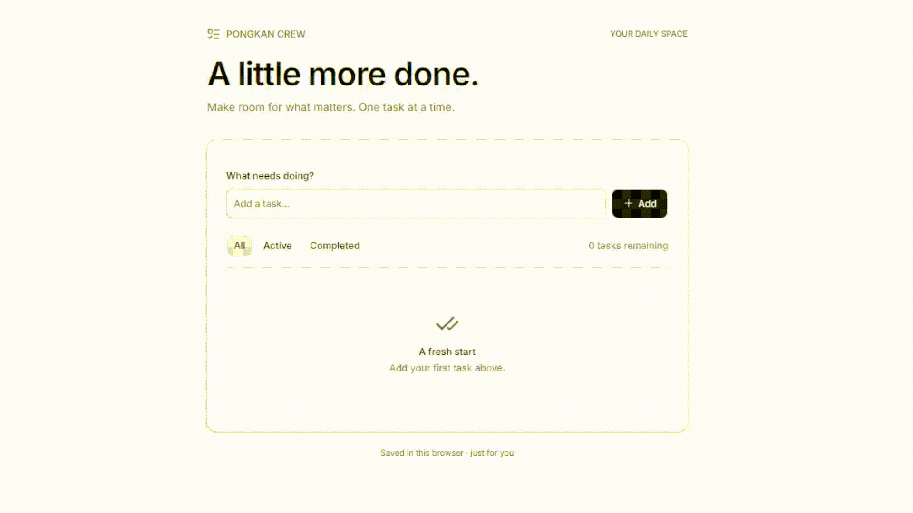

# Pongkan Crew

[Command reference](docs/COMMANDS.md) · [Todo website walkthrough](docs/TODO_WEBSITE_WALKTHROUGH.md) · [Contributing](CONTRIBUTING.md) · [Security](SECURITY.md) · [License](LICENSE)

Pongkan Crew runs named Codex teammates from a terminal. Chat with one teammate, ask the lead to coordinate a task, and follow the work in Activity. Each target folder has its own crew, conversations, and task history.

## Quick start

You need Node.js 22 or newer, the Codex CLI, and a signed-in Codex account. From the Pongkan Crew repository, run:

```powershell
node --version
codex --version
codex login
node .\src\cli.js
```

No `npm install` is needed. The default target is the current folder. To work on another existing project, pass its path:

```powershell
node .\src\cli.js --folder "C:\Projects\My Project"
```

Inside the CLI, use `/folder` to confirm the target. Enter `?` or `/help` for command help; press Ctrl+C to stop work and exit.

## Give the crew work

Plain text in Chat goes to the selected teammate. For example:

```text
/chat researcher
Explain this project's structure.
```

Use `/task GOAL` to let the lead plan assignments, arrange an independent review, and summarize results:

```text
/task Improve the README, check the instructions, and review the changes.
```

## Sample approach: local todo website

The walkthrough demonstrates a local-only todo app built with Next.js and shadcn/ui preset `b0`, using browser storage. See the [todo website walkthrough](docs/TODO_WEBSITE_WALKTHROUGH.md) for setup and the crew prompts.



[Open or download the full MP4](video/todo-result.mp4).

## Choose a crew

The default crew is Chief, Researcher, Developer, and Reviewer. Built-in presets add specialists for web, mobile, social, or content work. Preview and apply a preset with:

```text
/preset list
/preset show web
/preset apply web
```

Applying a preset archives the crew and starts fresh conversations, preserving project files and task history. Finish or cancel active work first; `/undo` restores the previous crew. To add one specialist instead, use `/roles list` and `/crew add NAME --role ROLE`.

The todo walkthrough uses the default crew; the web preset is optional.

## Chat, Crew Chat, and Activity

Chat holds individual conversations, Crew Chat holds shared discussions, and Activity follows the team's work.

### Task workflows and Crew Chat are separate

`/task GOAL` asks the lead to plan sequential assignments, send work to individual teammates, arrange an independent review, and summarize their results. Read each teammate's work in their individual Chat and the final summary in the lead's Chat. Use `/activity` to follow the whole workflow.

Crew Chat shows shared conversations started with `/discuss TOPIC` and directed replies requested with `@NAME MESSAGE`. Task assignments, handoffs, and results are not automatically copied into Crew Chat, so it can remain blank even while a `/task` workflow is running or has finished.

| What you want | Command | Where to follow it |
| --- | --- | --- |
| Coordinated implementation and review | `/task GOAL` | Individual Chat, lead's summary, and Activity |
| Read-only discussion with the crew | `/discuss TOPIC` | Crew Chat |
| One read-only reply using shared discussion context | `@NAME MESSAGE` | Crew Chat |

Tab/Shift+Tab cycles teammates and Crew Chat. F2 cycles views; PgUp/PgDn scroll. Switching views keeps work running.

Start a read-only group discussion from any view:

```text
/discuss How should we improve the navigation?
```

Teammates discuss for two rounds, then the lead summarizes. Discussions support up to twelve members and use separate sessions from individual chats.

## Everyday controls

| Need | Command |
| --- | --- |
| Check crew and progress | `/status`, `/crew list`, `/progress NAME` |
| Watch work | `/activity` |
| Inspect changes | `/changes`, `/diff` |
| Pause or resume queued work | `/queue pause`, `/queue resume` |
| Ask or answer a clarification | `/questions list`, `/answer TASK_ID TEXT` |
| Check Codex and folder access | `/doctor` |

Stopping does not undo edits; inspect `/diff` before retrying. The [command reference](docs/COMMANDS.md) covers recovery, permissions, models, and shortcuts.

## Saved data and access

Conversations, task results, archives, and session IDs live in `<target-folder>/.pongkan-crew/state.json`. Keep it private and add `.pongkan-crew/` to the **target project's** `.gitignore`. Pongkan Crew uses your Codex login without storing credentials.

Writers use workspace-write access; readers, reviewers, planning, and discussions use read-only access. Codex sandbox and approval settings control command execution.

## Troubleshooting

Run a startup check from the repository:

```powershell
node .\src\cli.js --doctor --folder "C:\Projects\My Project"
```

- If `node` or `codex` is not found, install it and reopen the terminal; use `codex login` to sign in.
- If the folder is already open, close its other Pongkan Crew instance.
- If a stale lock is reported, confirm the old process stopped, then delete only the reported `app.lock`. Keep `state.json`.
- If Codex discovery fails on Windows, set `PONGKAN_CODEX_BIN` to the full path of `codex.exe`.
- Use PgUp/PgDn to scroll; mouse-wheel scrolling is not supported.

## Development checks

From the repository, run the automated tests and offline display preview:

```powershell
node --test
node .\scripts\preview-display.js
node .\scripts\preview-display.js --activity
```

The offline previews do not call Codex or access crew state. Optional live integration checks use your signed-in account:

```powershell
node .\scripts\check-codex.js
node .\scripts\check-workflow.js
```

## License

Released under the [MIT License](LICENSE).
